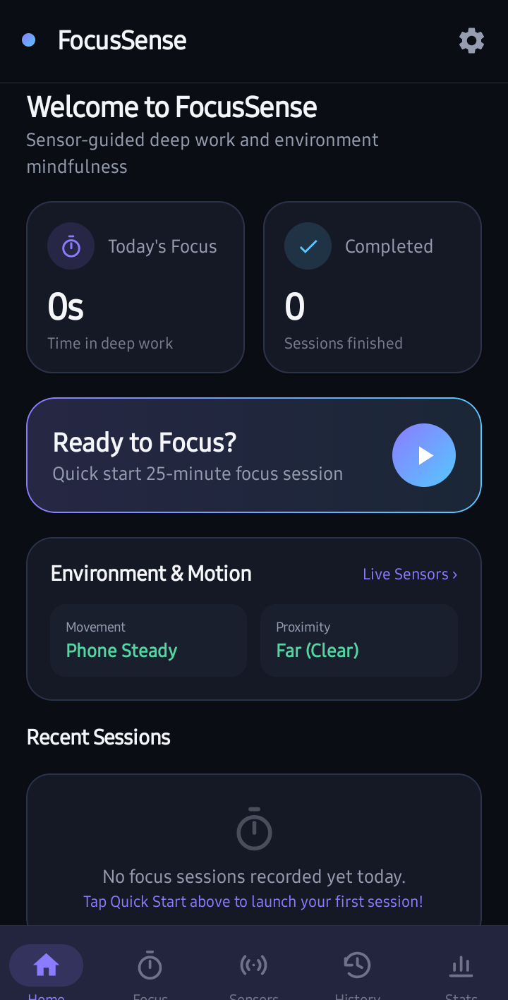
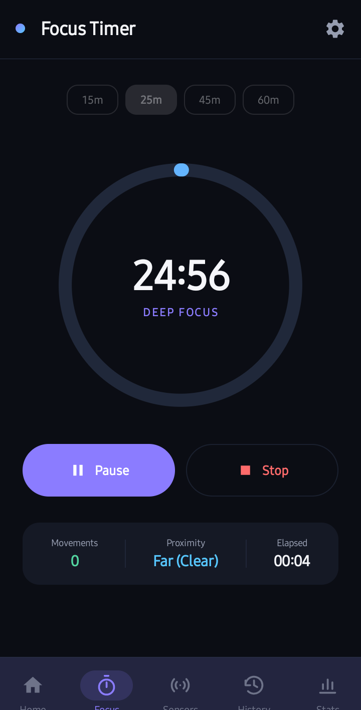
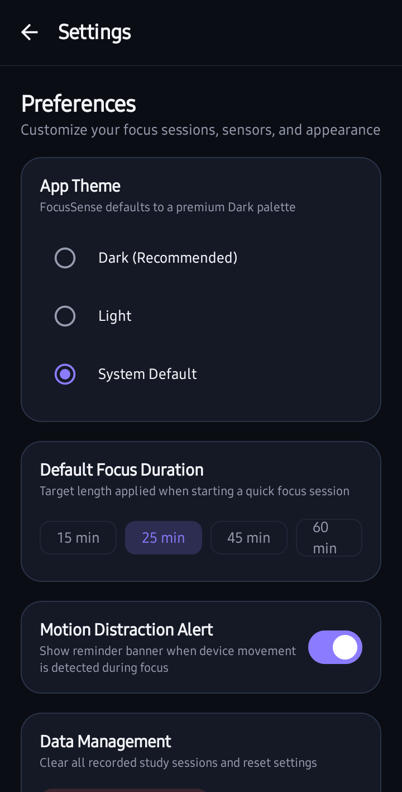

# FocusSense — Aplikasi Manajemen Fokus Belajar & Pemantau Sensor Lingkungan Android

<p align="center">
  
  
  
  
  
  
</p>

---

## 📌 Daftar Isi / Table of Contents
- [Versi Bahasa Indonesia](#-versi-bahasa-indonesia)
  1. [Nama & Deskripsi Aplikasi](#1-nama--deskripsi-aplikasi)
  2. [Fitur-Fitur Utama](#2-fitur-fitur-utama)
  3. [Teknologi & Arsitektur](#3-teknologi--arsitektur)
  4. [Sensor Hardware & Fungsinya](#4-sensor-hardware--fungsinya)
  5. [Screenshot Tampilan Aplikasi](#5-screenshot-tampilan-aplikasi)
  6. [Panduan Menjalankan Aplikasi](#6-panduan-menjalankan-aplikasi)
- [English Version](#-english-version)
  1. [Application Name & Description](#1-application-name--description)
  2. [Key Features](#2-key-features)
  3. [Technology Stack & Architecture](#3-technology-stack--architecture)
  4. [Hardware Sensors & Functionality](#4-hardware-sensors--functionality)
  5. [Application Screenshots](#5-application-screenshots)
  6. [How to Run the Application](#6-how-to-run-the-application)

---

# 🇮🇩 VERSI BAHASA INDONESIA

## 1. Nama & Deskripsi Aplikasi

**Nama Aplikasi:** **FocusSense**  
**Paket Aplikasi:** `com.focussense.app`  
**Target Pengguna:** Pelajar, Mahasiswa, dan Profesional yang ingin meningkatkan produktivitas serta fokus belajar bebas distraksi.

### Deskripsi
**FocusSense** adalah aplikasi Android berbasis *productivity & ergonomics* yang menggabungkan teknik manajemen waktu Pomodoro dengan pemantauan sensor perangkat keras (*hardware sensors*) secara *real-time*. 

Berbeda dengan aplikasi pengatur waktu biasa, FocusSense memanfaatkan sensor fisik pada *smartphone* untuk mengawasi kondisi lingkungan dan perilaku pengguna saat sesi belajar berlangsung:
- **Mendeteksi Gangguan Fisik:** Mengetahui saat perangkat diangkat, digeser, atau digoyangkan ketika pengguna seharusnya fokus.
- **Memantau Kondisi Lingkungan:** Mengukur pencahayaan ruangan atau jarak perangkat guna menjaga ergonomi belajar yang optimal.
- **Pencatatan Refleksi & Evaluasi:** Menyimpan data sesi belajar beserta evaluasi gerakan dan pencahayaan secara otomatis ke database lokal.

---

## 2. Fitur-Fitur Utama

| Fitur | Deskripsi |
| :--- | :--- |
| **Monotonic Focus Timer** | Penghitung waktu presisi tinggi berbasis `SystemClock.elapsedRealtime()` yang tidak terpengaruh oleh perubahan jam sistem maupun mode hemat daya (*Doze mode*). |
| **Preset Durasi Cepat** | Pilihan durasi fokus instan: 15 menit, 25 menit (standar Pomodoro), 45 menit, dan 60 menit. |
| **Real-Time Motion Alert** | Peringatan visual dan getar ketika perangkat diangkat atau digerakkan secara berlebih saat sesi fokus sedang aktif. |
| **Hardware Telemetry Dashboard** | Pemantauan langsung status sensor fisik, nilai pembacaan live (*real-time*), batas ukur (*range*), daya, dan rekomendasi ergonomis. |
| **Dynamic Sensor Adaptation** | Kemampuan adaptasi otomatis terhadap perangkat keras: mendeteksi sensor cahaya (*Ambient Light*), dan secara cerdas beralih ke sensor jarak (*Proximity*) apabila sensor cahaya tidak tersedia pada perangkat tertentu (contoh: Samsung Galaxy M12). |
| **Riwayat Sesi (History) & Catatan** | Penyimpanan sesi belajar (*Completed*, *Interrupted*, *Cancelled*) lengkap dengan waktu, durasi riil, jumlah gerakan, dan catatan refleksi yang dapat diedit. |
| **Statistik & Grafik Mingguan** | Dashboard visualisasi data belajar dengan grafik batang 7 hari terakhir, total jam belajar, sesi terselesaikan, dan tingkat keberhasilan (*completion rate*). |
| **Pengaturan & Personalisasi** | Kustomisasi durasi default, pengaktifan/penonaktifan sensor gerak, pemilihan tema (Dark, Light, System), dan reset data yang aman. |

---

## 3. Teknologi & Arsitektur

FocusSense dibangun dengan standar modern *Android Development Best Practices* menggunakan pendekatan **Clean Architecture** dan pola desain **MVVM (Model-View-ViewModel)**.

```
┌─────────────────────────────────────────────────────────────┐
│                   Jetpack Compose UI Layer                  │
│       (Screens, Custom Components, Material 3 Dark-First)   │
└──────────────────────────────┬──────────────────────────────┘
                               │ Observasi StateFlow & Kirim Event
                               ▼
┌─────────────────────────────────────────────────────────────┐
│                     Presentation Layer                      │
│     (HomeViewModel, FocusTimerViewModel, SensorsViewModel,  │
│      HistoryViewModel, StatisticsViewModel, SettingsViewModel│
└──────────────────────────────┬──────────────────────────────┘
                               │ Menjalankan Logika Bisnis
                               ▼
┌─────────────────────────────────────────────────────────────┐
│                        Domain Layer                         │
│     (FocusTimerEngine, Monotonic TimeProvider, Model Mapper,│
│      StatisticsCalculator, SessionState & Aggregators)      │
└──────────────────────────────┬──────────────────────────────┘
                               │ Koordinasi Data & Hardware
               ┌───────────────┴───────────────┐
               ▼                               ▼
┌─────────────────────────────┐ ┌─────────────────────────────┐
│        Data Layer           │ │       Hardware Sensors      │
│  - Room Database (SQLite)   │ │  - Android SensorManager    │
│  - DAOs & Entities          │ │  - AccelerometerMonitor     │
│  - DataStore Preferences    │ │  - AmbientLightMonitor      │
│  - Repository Pattern       │ │  - ProximityMonitor         │
└─────────────────────────────┘ └─────────────────────────────┘
```

### Stack Teknologi
- **Bahasa Pemrograman:** Kotlin `2.2.10` (Modern, expressive, & null-safe)
- **UI Framework:** Jetpack Compose dengan Material Design 3 (`androidx.compose.material3:1.3.1`)
- **Arsitektur:** Clean Architecture + MVVM + Unidirectional Data Flow (UDF)
- **Database Lokal:** SQLite via AndroidX Room `2.8.5` (dengan Google KSP 2)
- **Manajemen State & Asinkron:** Kotlin Coroutines & Reactive `StateFlow`
- **Penyimpanan Konfigurasi:** AndroidX DataStore Preferences `1.1.2`
- **Navigasi:** AndroidX Navigation Compose `2.8.8`
- **Build Tool:** Gradle `9.5.0` & Android Gradle Plugin (AGP) `9.3.3`
- **Target SDK:** Android 15 (API 35) | **Minimum SDK:** Android 8.0 Oreo (API 26)

---

## 4. Sensor Hardware & Fungsinya

Aplikasi berinteraksi langsung dengan sensor fisik Android melalui `SensorManager` menggunakan delay frekuensi `SENSOR_DELAY_NORMAL` agar efisien terhadap konsumsi baterai dan CPU:

### 1. Accelerometer (`Sensor.TYPE_ACCELEROMETER`)
- **Fungsi:** Mendeteksi pergerakan fisik perangkat selama sesi belajar berlangsung.
- **Implementasi:** Menghitung selisih magnitudo vektor 3D Euclidean antara frame berurutan:
  $$\Delta = \sqrt{(x_2 - x_1)^2 + (y_2 - y_1)^2 + (z_2 - z_1)^2}$$
- **Logika & Kalibrasi:** 
  - Getaran statis di atas meja (*resting jitter* $0.01 - 0.05 \text{ m/s}^2$) difilter agar tidak terhitung.
  - Ambang batas (*threshold*) $1.8 \text{ m/s}^2$ digunakan untuk mendeteksi tindakan nyata seperti mengangkat atau memainkan ponsel.
  - Terdapat mekanisme *debouncing* (cooldown $1.5$ detik) untuk menghindari penghitungan ganda pada satu gerakan berkelanjutan.

### 2. Ambient Light Sensor (`Sensor.TYPE_LIGHT`)
- **Fungsi:** Mengukur intensitas cahaya ruangan dalam satuan Lux ($\text{lx}$) untuk memastikan kondisi pencahayaan ramah mata saat belajar.
- **Kategori Ergonomi:**
  - `< 50 lx` (`Sangat Redup`): Peringatan risiko kelelahan mata tinggi; disarankan menyalakan lampu meja.
  - `50 - 200 lx` (`Redup`): Cukup untuk layar, namun kurang optimal untuk membaca buku/catatan fisik.
  - `200 - 500 lx` (`Optimal`): Standar pencahayaan belajar yang direkomendasikan ISO.
  - `> 500 lx` (`Terang`): Pencahayaan sangat terang / siang hari terbuka.
- **Integrasi Sesi:** Nilai rata-rata pencahayaan selama sesi disimpan ke SQLite sebagai histori kenyamanan belajar.

### 3. Proximity Sensor (`Sensor.TYPE_PROXIMITY`) — Adaptasi Hardware
- **Fungsi:** Sensor alternatif cerdas (*hardware fallback*) yang aktif secara dinamis apabila perangkat pengguna tidak menyediakan sensor cahaya publik (seperti pada Samsung Galaxy M12).
- **Implementasi:** Mendeteksi status jarak objek terhadap layar (*Near / Far*) tanpa manipulasi atau pemalsuan data, memberikan informasi bahwa perangkat berada dalam posisi terlindungi atau diletakkan dengan baik.

---

## 5. Screenshot Tampilan Aplikasi

Berikut adalah dokumentasi tampilan antarmuka (UI) aplikasi **FocusSense** yang diambil langsung dari perangkat fisik:

| 1. Home Screen | 2. Focus Timer (Idle) | 3. Focus Timer (Running) |
| :---: | :---: | :---: |
|  |  |  |
| *Ringkasan progres harian, tombol Quick Start, dan status live sensor.* | *Pilihan durasi fokus (15m–60m) dan visualisasi circular progress.* | *Timer berjalan dengan deteksi gerakan aktif dan tombol jeda/selesai.* |

| 4. Hardware Sensors | 5. History Screen | 6. Statistics Screen |
| :---: | :---: | :---: |
|  |  |  |
| *Telemetri live Accelerometer & Proximity/Light secara dinamis.* | *Riwayat sesi belajar, filter status, dan catatan refleksi pengguna.* | *Grafik batang aktivitas 7 hari dan metrik pencapaian belajar.* |

<p align="center">
  <b>7. Settings Screen</b><br/>
  <br/>
  <i>Pengaturan tema (Dark/Light/System), durasi default, toggle sensor gerak, dan manajemen data.</i>
</p>

---

## 6. Panduan Menjalankan Aplikasi

### Prasyarat
1. **Java Development Kit (JDK):** OpenJDK versi 21 atau Android Studio JBR.
2. **Android SDK:** Platform `android-35` dengan Build-Tools `35.0.0`.
3. **Perangkat Uji:** Smartphone Android fisik (disarankan untuk menguji sensor fisik) atau Android Virtual Device (AVD).

### Langkah-Langkah Build & Install

```bash
# 1. Kloning repository dari GitHub
git clone https://github.com/verjosee/FocusSense.git
cd FocusSense

# 2. Compile & Build Debug APK menggunakan Gradle Wrapper
# (Di Windows CMD / PowerShell)
gradlew.bat assembleDebug
# (Di Linux / macOS)
./gradlew assembleDebug

# Lokasi file APK output:
# app/build/outputs/apk/debug/app-debug.apk

# 3. Jalankan pengujian otomatis (Unit Test)
gradlew.bat test

# 4. Pasang (Install) APK ke perangkat Android fisik yang terhubung via ADB
adb install -r app/build/outputs/apk/debug/app-debug.apk
```

---
---

# 🇬🇧 ENGLISH VERSION

## 1. Application Name & Description

**Application Name:** **FocusSense**  
**Package Identifier:** `com.focussense.app`  
**Target Audience:** Students, Academics, and Knowledge Workers aiming to maximize uninterrupted focus and maintain ergonomic study environments.

### Description
**FocusSense** is an academic-grade Android productivity and environmental ergonomics application that integrates the Pomodoro study technique with real-time physical hardware sensor telemetry.

Unlike generic timer applications, FocusSense communicates directly with onboard device hardware to monitor study integrity and ambient conditions:
- **Distraction Detection:** Identifies device displacement, movement, and pickups when the user should be immersed in study.
- **Environmental Awareness:** Evaluates ambient light illuminance or proximity status to encourage comfortable and healthy study environments.
- **Reflective Analytics:** Automatically commits focus duration, movement count, and lighting averages into a local SQLite database for retrospective analysis.

---

## 2. Key Features

- **Monotonic Precision Timer:** Relies on `SystemClock.elapsedRealtime()` to guarantee microsecond precision impervious to system clock adjustments or battery optimization throttling.
- **Rapid Duration Presets:** One-tap presets for 15m, 25m (standard Pomodoro), 45m, and 60m focus blocks.
- **Physical Motion Detection:** Real-time 3D vector calculation alerts users when excessive phone handling occurs during an active session.
- **Live Hardware Sensors Screen:** In-depth hardware telemetry displaying real-time readings, sensor vendors, versions, power draw, and actionable ergonomic guidance.
- **Smart Hardware Adaptation:** Dynamically detects installed sensors; natively monitors Ambient Light, or seamlessly switches to the Proximity sensor when Ambient Light is unavailable (e.g. on Samsung Galaxy M12 hardware).
- **Session History & Reflection:** Comprehensive session log (*Completed*, *Interrupted*, *Cancelled*) with editable reflection notes.
- **Interactive 7-Day Analytics:** Beautiful weekly distribution bar chart, total study hours, session completion rates, and daily milestones.
- **Customizable Preferences:** Configurable default timer durations, motion alert toggles, theme switching (Dark, Light, System Default), and safe database reset capabilities.

---

## 3. Technology Stack & Architecture

Built in accordance with Google's recommended modern Android architecture guidelines using **Clean Architecture** and **MVVM (Model-View-ViewModel)** with Unidirectional Data Flow (UDF).

| Layer / Component | Technology | Specification / Version |
| :--- | :--- | :--- |
| **Language** | Kotlin | `2.2.10` |
| **UI Toolkit** | Jetpack Compose (BOM) | Material 3 (`1.3.1`) |
| **Local Persistence** | SQLite via Room | `2.8.5` (with KSP 2) |
| **Asynchronous Streaming**| Kotlin Coroutines & Flow | `StateFlow` & `SharedFlow` |
| **Preferences Store** | AndroidX DataStore | `1.1.2` |
| **In-App Navigation** | Navigation Compose | `2.8.8` |
| **Build Automation** | Gradle & AGP | Gradle `9.5.0` / AGP `9.3.3` |
| **Target Compatibility** | Android SDK | Min: API 26 (Android 8.0) / Target: API 35 (Android 15) |

---

## 4. Hardware Sensors & Functionality

FocusSense registers hardware listeners via Android's `SensorManager` with `SENSOR_DELAY_NORMAL` to ensure optimal performance and minimal battery draw:

### 1. Accelerometer (`Sensor.TYPE_ACCELEROMETER`)
- **Role:** Tracks physical handling and movement during study intervals.
- **Math:** Computes 3D Euclidean acceleration delta:
  $$\Delta = \sqrt{\Delta x^2 + \Delta y^2 + \Delta z^2}$$
- **Calibration:** Filters out normal desk vibration ($0.01 - 0.05 \text{ m/s}^2$) with a calibrated $1.8 \text{ m/s}^2$ threshold and a $1.5\text{s}$ debounce timer.

### 2. Ambient Light Sensor (`Sensor.TYPE_LIGHT`)
- **Role:** Measures room illuminance in Lux ($\text{lx}$) to prevent eye strain.
- **Standards:**
  - `< 50 lx`: `Very Dim` (Severe eye strain risk; task lighting required).
  - `50 - 200 lx`: `Dim` (Acceptable for backlit screens; insufficient for paper notes).
  - `200 - 500 lx`: `Optimal` (Meets ISO study lighting standards).
  - `> 500 lx`: `Bright` (Daylight / high ambient illumination).

### 3. Proximity Sensor (`Sensor.TYPE_PROXIMITY`)
- **Role:** Dynamic fallback sensor for hardware configurations where ambient light sensors are restricted or absent (e.g., Samsung Galaxy M12).
- **Execution:** Reports real-time binary near/far object detection without simulated or synthetic data.

---

## 5. Application Screenshots

| 1. Home Screen | 2. Focus Timer (Idle) | 3. Focus Timer (Running) |
| :---: | :---: | :---: |
|  |  |  |

| 4. Hardware Sensors | 5. History Screen | 6. Statistics Screen |
| :---: | :---: | :---: |
|  |  |  |

<p align="center">
  <b>7. Settings Screen</b><br/>
  
</p>

---

## 6. How to Run the Application

### Prerequisites
- **JDK:** OpenJDK 21
- **Android SDK:** Platforms `android-35` and Build Tools `35.0.0`
- **Device:** Physical Android phone (recommended for sensor testing) or Android Emulator

### Build & Installation Commands

```bash
# 1. Clone the repository
git clone https://github.com/verjosee/FocusSense.git
cd FocusSense

# 2. Assemble Debug APK
gradlew.bat assembleDebug

# Output APK path:
# app/build/outputs/apk/debug/app-debug.apk

# 3. Execute Automated Unit Tests
gradlew.bat test

# 4. Install onto connected Android hardware
adb install -r app/build/outputs/apk/debug/app-debug.apk
```

---

<p align="center">
  Developed with dedication for academic productivity and digital well-being.<br/>
  <b>Repository URL:</b> <a href="https://github.com/verjosee/FocusSense">https://github.com/verjosee/FocusSense</a>
</p>
