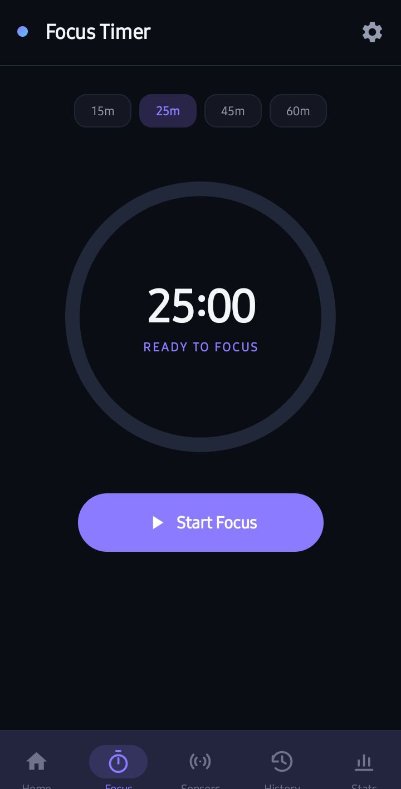
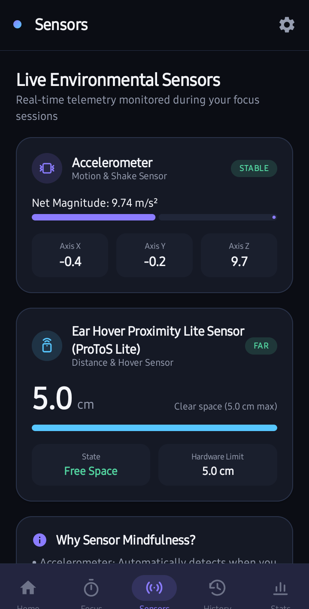
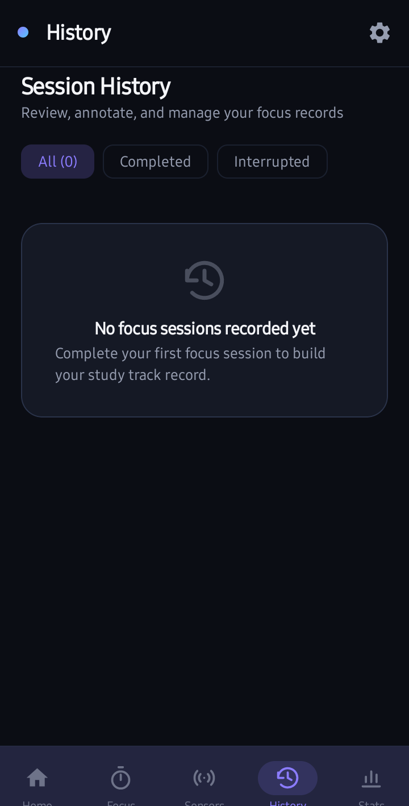
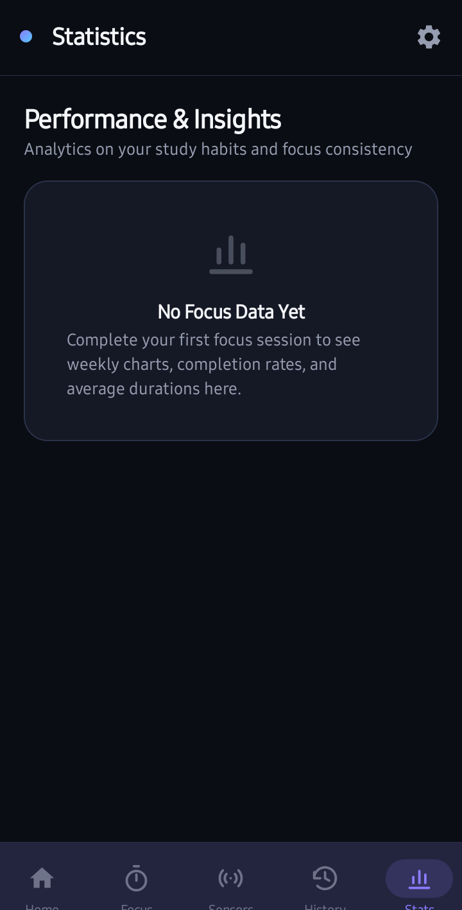

# FocusSense

Aplikasi Android untuk membantu mengatur waktu belajar dengan teknik fokus serta memanfaatkan sensor bawaan HP untuk memantau pergerakan dan lingkungan saat belajar.

---

## Daftar Isi / Table of Contents
- [Versi Bahasa Indonesia](#-versi-bahasa-indonesia)
  1. [Tentang Aplikasi](#1-tentang-aplikasi)
  2. [Fitur Aplikasi](#2-fitur-aplikasi)
  3. [Teknologi yang Digunakan](#3-teknologi-yang-digunakan)
  4. [Sensor yang Digunakan](#4-sensor-yang-digunakan)
  5. [Screenshot Aplikasi](#5-screenshot-aplikasi)
  6. [Cara Menjalankan Aplikasi](#6-cara-menjalankan-aplikasi)
- [English Version](#-english-version)
  1. [About the Application](#1-about-the-application)
  2. [Features](#2-features)
  3. [Technologies Used](#3-technologies-used)
  4. [Sensors Used](#4-sensors-used)
  5. [Application Screenshots](#5-application-screenshots)
  6. [How to Run the Application](#6-how-to-run-the-application)

---

# 🇮🇩 VERSI BAHASA INDONESIA

## 1. Tentang Aplikasi

**FocusSense** adalah aplikasi pengatur waktu belajar (timer fokus) yang dirancang untuk membantu siswa belajar dengan lebih teratur dan bebas dari gangguan ponsel.

Aplikasi ini menggabungkan teknik manajemen waktu belajar dengan sensor fisik yang ada di dalam *smartphone*. Ketika sesi fokus sedang berlangsung, FocusSense dapat mendeteksi apakah ponsel diangkat atau digerakkan, serta menampilkan informasi sensor perangkat secara langsung untuk mendukung suasana belajar yang kondusif.

---

## 2. Fitur Aplikasi

Berikut adalah fitur-fitur yang tersedia di dalam aplikasi FocusSense:

1. **Timer Fokus Belajar**
   - Menghitung mundur waktu belajar dengan tampilan lingkaran progres (*circular progress*) yang jelas.
   - Pilihan durasi belajar: 15 menit, 25 menit (standar Pomodoro), 45 menit, dan 60 menit.
   - Tombol kendali: Mulai (*Start*), Jeda (*Pause*), Lanjutkan (*Resume*), dan Selesai/Berhenti (*Stop*).

2. **Peringatan Gerakan Ponsel (*Motion Alert*)**
   - Mendeteksi jika ponsel digerakkan atau diangkat saat sesi belajar aktif.
   - Memberikan tanda peringatan visual dan getaran agar pengguna meletakkan kembali ponsel dan fokus belajar.

3. **Halaman Pemantau Sensor (*Sensors Screen*)**
   - Menampilkan daftar sensor perangkat keras yang aktif secara langsung (*real-time*).
   - Menampilkan nilai koordinat percepatan gerak serta status sensor jarak/cahaya.

4. **Riwayat Sesi Belajar (*History*)**
   - Menyimpan seluruh data sesi belajar (selesai maupun terhenti) ke database lokal perangkat.
   - Mencatat waktu mulai, durasi belajar nyata, dan jumlah gerakan ponsel yang terdeteksi.
   - Menyediakan fitur untuk menambah dan mengedit catatan refleksi belajar pada setiap sesi.

5. **Statistik Belajar (*Statistics*)**
   - Menampilkan ringkasan total waktu belajar, durasi belajar hari ini, dan jumlah sesi yang selesai.
   - Menyediakan grafik batang aktivitas 7 hari terakhir untuk melihat kebiasaan belajar mingguan.

6. **Pengaturan Aplikasi (*Settings*)**
   - Pilihan tema tampilan: Mode Gelap (*Dark*), Mode Terang (*Light*), atau Mengikuti Sistem.
   - Mengatur durasi belajar bawaan (*default*).
   - Menghidupkan atau mematikan fitur peringatan sensor gerak.
   - Fitur hapus data riwayat belajar jika ingin mengulang dari awal.

---

## 3. Teknologi yang Digunakan

Aplikasi ini dibangun menggunakan teknologi resmi dan standar pengembangan aplikasi Android modern:

| Teknologi | Penjelasan Sederhana |
| :--- | :--- |
| **Kotlin** | Bahasa pemrograman utama yang digunakan untuk membuat seluruh kode aplikasi. |
| **Jetpack Compose** | Toolkit modern dari Google untuk mendesain tampilan antarmuka (UI) menggunakan kode Kotlin langsung tanpa file layout XML. |
| **MVVM (Model-View-ViewModel)** | Pola arsitektur yang memisahkan bagian tampilan (**View**), pengelola alur data (**ViewModel**), dan sumber data (**Model**) agar kode rapi dan mudah dirawat. |
| **SQLite / Room Database** | Database lokal di dalam perangkat Android untuk menyimpan data riwayat belajar secara aman dan permanen. |
| **Android Sensor API** | Layanan resmi Android (`SensorManager`) untuk membaca data dari sensor fisik yang terpasang di HP. |
| **DataStore Preferences** | Penyimpanan lokal ringan untuk menyimpan preferensi pengguna seperti tema dan durasi default. |

---

## 4. Sensor yang Digunakan

Aplikasi FocusSense memanfaatkan sensor fisik bawaan perangkat melalui sistem Android:

| Nama Sensor | Fungsi Sensor | Contoh Penggunaan di Aplikasi |
| :--- | :--- | :--- |
| **Accelerometer** (`Sensor.TYPE_ACCELEROMETER`) | Mengukur gaya percepatan dan pergerakan ponsel pada sumbu 3 dimensi (X, Y, Z). | Sensor utama untuk mendeteksi apakah ponsel diangkat, digeser, atau dimainkan saat sesi fokus sedang berjalan. Jika terdeteksi bergerak, aplikasi memunculkan peringatan gerak. |
| **Proximity Sensor** (`Sensor.TYPE_PROXIMITY`) | Mengukur jarak objek di dekat bagian depan layar ponsel (menghasilkan status *Near* / Dekat atau *Far* / Jauh). | Sensor lingkungan untuk mendeteksi apakah layar ponsel tertutup atau diletakkan menghadap permukaan meja saat belajar. |
| **Ambient Light Sensor** (`Sensor.TYPE_LIGHT`) | Mengukur tingkat intensitas pencahayaan di sekitar ruangan dalam satuan Lux. | Sensor lingkungan untuk memantau apakah ruangan tempat belajar memiliki penerangan yang cukup agar mata tidak cepat lelah (aktif jika perangkat memiliki sensor cahaya fisik). |

> **Informasi Ketersediaan Sensor:**  
> Setiap tipe smartphone memiliki kelengkapan sensor fisik yang berbeda-beda. FocusSense menggunakan **Accelerometer** sebagai sensor pemantau gerak utama, dan secara otomatis mendeteksi sensor lingkungan yang tersedia di perangkat (apakah **Proximity Sensor** atau **Ambient Light Sensor**) sehingga aplikasi tetap berjalan dengan stabil di berbagai perangkat.

---

## 5. Screenshot Aplikasi

Dokumentasi tampilan antarmuka aplikasi FocusSense yang diambil langsung dari perangkat HP fisik:

| 1. Halaman Utama (Home) | 2. Timer Belajar (Siap Mulai) | 3. Timer Berjalan (Running) |
| :---: | :---: | :---: |
|  |  |  |
| *Ringkasan progres belajar hari ini dan status sensor aktif.* | *Pilihan preset waktu (15-60 menit) dan tombol mulai.* | *Timer berjalan dengan pemantau sensor gerak aktif.* |

| 4. Pemantau Sensor | 5. Riwayat Belajar (History) | 6. Statistik & Grafik |
| :---: | :---: | :---: |
|  |  |  |
| *Data pembacaan sensor fisik yang terdeteksi di perangkat.* | *Daftar sesi belajar yang tersimpan beserta catatan refleksi.* | *Grafik batang 7 hari dan metrik pencapaian belajar.* |

<p align="center">
  <b>7. Pengaturan (Settings)</b><br/>
  <br/>
  <i>Pilihan tema tampilan, durasi default, dan tombol aktivasi sensor gerak.</i>
</p>

---

## 6. Cara Menjalankan Aplikasi

Langkah-langkah untuk menjalankan proyek FocusSense:

1. **Unduh Proyek (Clone Repository)**
   ```bash
   git clone https://github.com/verjosee/FocusSense.git
   ```
2. **Buka di Android Studio**
   - Buka aplikasi **Android Studio**.
   - Pilih menu **File > Open**, lalu arahkan ke folder proyek **FocusSense**.
3. **Sinkronisasi Gradle (Gradle Sync)**
   - Tunggu proses *Gradle Sync* selesai secara otomatis agar seluruh dependensi terpasang.
4. **Jalankan Aplikasi**
   - Sambungkan HP Android fisik menggunakan kabel data (pastikan mode *USB Debugging* aktif) atau gunakan Emulator Android Studio.
   - Klik tombol **Run** (ikon segitiga hijau `▶`) di toolbar atas Android Studio.

*(Opsi Build lewat Terminal)*:
```bash
# Membuat file APK Debug
gradlew.bat assembleDebug

# Menginstal APK ke perangkat melalui ADB
adb install -r app/build/outputs/apk/debug/app-debug.apk
```

---
---

# 🇬🇧 ENGLISH VERSION

## 1. About the Application

**FocusSense** is an Android productivity timer application created to help students maintain focused study routines and minimize phone distractions.

The application integrates standard study time management with onboard device sensors. During an active focus block, FocusSense detects whether the phone is moved or picked up and displays live hardware sensor telemetry to foster a disciplined study environment.

---

## 2. Features

1. **Focus Study Timer**
   - Countdown timer with an intuitive circular progress indicator.
   - Preset durations: 15, 25 (standard Pomodoro), 45, and 60 minutes.
   - Timer controls: Start, Pause, Resume, and Stop.

2. **Motion Alert**
   - Detects physical movement if the phone is picked up or moved during study time.
   - Provides an on-screen warning and haptic feedback to remind students to stay focused.

3. **Live Sensors Screen**
   - Displays real-time hardware telemetry and readings from physical sensors.
   - Shows live coordinate acceleration values and proximity/ambient status.

4. **Study History & Reflection Notes**
   - Saves all completed and interrupted study sessions into a local database.
   - Records session date, time, actual duration, and movement events.
   - Allows students to write and edit reflection notes for each study block.

5. **Study Statistics**
   - Displays total study hours, today's focused time, and completed session count.
   - Features a 7-day bar chart showing daily study progress.

6. **Application Settings**
   - Theme options: Dark Mode, Light Mode, or Follow System.
   - Default study duration preference.
   - Toggle to turn the motion alert on or off.
   - Option to clear local study history.

---

## 3. Technologies Used

| Technology | Description |
| :--- | :--- |
| **Kotlin** | Primary programming language used across the entire application. |
| **Jetpack Compose** | Google's modern declarative UI toolkit used to design screens in Kotlin without XML files. |
| **MVVM (Model-View-ViewModel)** | Architectural design pattern separating the UI (**View**), data logic (**ViewModel**), and storage (**Model**). |
| **Room Database (SQLite)** | Android local persistence library to securely store study session history on the device. |
| **Android Sensor API** | Native Android framework (`SensorManager`) used to read hardware sensor values. |
| **DataStore Preferences** | Key-value storage for app settings such as theme and timer preferences. |

---

## 4. Sensors Used

| Sensor Name | Function | Application Usage |
| :--- | :--- | :--- |
| **Accelerometer** (`Sensor.TYPE_ACCELEROMETER`) | Measures acceleration forces along the X, Y, and Z axes. | Primary sensor used to detect whether the user picks up or moves the phone during study sessions, triggering a motion alert. |
| **Proximity Sensor** (`Sensor.TYPE_PROXIMITY`) | Measures whether an object is close to the front of the screen (*Near* or *Far*). | Environmental sensor that detects if the phone screen is covered or placed face-down on a desk. |
| **Ambient Light Sensor** (`Sensor.TYPE_LIGHT`) | Measures surrounding ambient light levels in Lux. | Environmental sensor used to evaluate if study room lighting is adequate (active on devices that feature a hardware light sensor). |

> **Sensor Availability Note:**  
> Hardware configurations vary across Android phones. FocusSense uses the **Accelerometer** as the primary motion monitor and dynamically checks available environmental sensors (**Proximity** or **Ambient Light**) to maintain stability on different devices.

---

## 5. Application Screenshots

| 1. Home Screen | 2. Focus Timer (Idle) | 3. Focus Timer (Running) |
| :---: | :---: | :---: |
|  |  |  |

| 4. Sensors Screen | 5. History Screen | 6. Statistics Screen |
| :---: | :---: | :---: |
|  |  |  |

<p align="center">
  <b>7. Settings Screen</b><br/>
  
</p>

---

## 6. How to Run the Application

1. **Clone the Repository**
   ```bash
   git clone https://github.com/verjosee/FocusSense.git
   ```
2. **Open in Android Studio**
   - Launch **Android Studio**.
   - Select **File > Open** and open the **FocusSense** project directory.
3. **Gradle Sync**
   - Wait for the automatic Gradle Sync process to finish.
4. **Run on Device / Emulator**
   - Connect an Android device via USB with *USB Debugging* enabled or launch an Android Emulator.
   - Click the green **Run** button (`▶`) in Android Studio.
